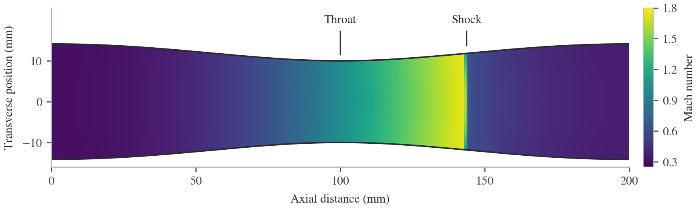
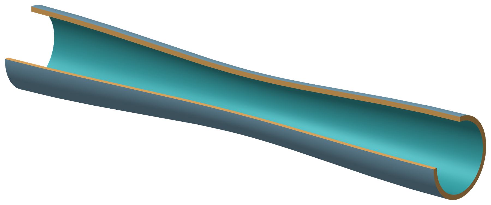

# Back pressure in a converging–diverging air nozzle

**Karim El Zahran**

How can air go supersonic inside a nozzle and still leave at Mach 0.38? At a back pressure of 75 kPa, a normal shock forms in the diverging section. Lower the back pressure to 9.393 kPa and the same nozzle delivers Mach 2.20 at the exit. Both simulations pass 73.31 grams of air per second to the precision reported.

[Read the five-page report](Report/Nozzle-Report.pdf) · [Open the nozzle CAD file](CAD/Air_Nozzle_3D.step) · [Explore the run data](Results/case_summary.csv)



*Mach number on the finest grid. The shock appears about 144 mm from the inlet. The lower half mirrors the computed upper half, and the radial scale is enlarged.*

## Four back pressures

The nozzle is 200 mm long, with a 20 mm throat diameter and an exit-to-throat area ratio of two. The inlet total pressure was 100 kPa and the inlet total temperature was 300 K in all four cases. The values below come from the 128 × 8 grid. Pressures are absolute.

| Back pressure (kPa) | Flow condition | Exit Mach | Inlet mass flow (g/s) |
| ---: | --- | ---: | ---: |
| 98.000 | Subsonic throughout | 0.1701 | 42.35 |
| 93.716 | Theoretical onset of choking | 0.3058 | 73.27 |
| 75.000 | Internal shock | 0.3805 | 73.31 |
| 9.393 | Matched supersonic exit | 2.1970 | 73.31 |

Figure 3 in the report shows where the Mach and pressure profiles separate. At 75 kPa, the fine-grid pressure jump falls at 143.75 mm. Quasi-one-dimensional theory predicts 143.61 mm. The 0.14 mm difference is smaller than the 0.78 mm axial cell width. All three grids share a face at that location. Table 2 also compares exit Mach and mass conservation across the grids.

## Geometry and results



| To inspect | Open |
| --- | --- |
| Hollow nozzle in SOLIDWORKS or another STEP-compatible CAD program | [3D nozzle](CAD/Air_Nozzle_3D.step) |
| Computational geometry | [3D air volume](CAD/Air_Volume_3D.step) · [2D meridional section](CAD/CFD_Fluid_Section_2D.step) |
| Implementation and analytical reference | [C++ finite-volume solver](Source/nozzle_euler.cpp) · [Python gas-dynamics model](Source/model.py) |
| Fine-grid shock result | [Mach and pressure profiles (CSV)](Results/shock_256x16/axial_profile.csv) · [Field for ParaView (VTU)](Results/shock_256x16/flow.vtu) |
| Comparison with analytical profiles | [Quasi-one-dimensional solutions (CSV)](Results/quasi1D_reference.csv) |
| Meshes and an optional independent Fluent setup | [Meshes](Mesh/) · [Setup notes](Mesh/Fluent_Setup.md) |

The C++ solver produced the reported results. It solves the axisymmetric Euler equations for ideal air with an adiabatic slip wall. The calculations cover the internal flow up to the exit. Wall friction, shock-induced separation and the external jet are outside the model.

## Reproduce the CFD

Use Python 3.10 or later and a C++17 compiler. The following commands run from the repository root.

```sh
python -m pip install numpy matplotlib
python Source/reproduce.py
```

The script compiles the solver, runs the four back pressures on the 128 × 8 grid, and repeats the internal-shock case on the 64 × 4 and 256 × 16 grids. It writes meshes, CSV data, ParaView fields and plots to a new `reproduced/` directory. To run again, choose a fresh directory with `--output`.

## References

- Ames Research Staff, *Equations, Tables, and Charts for Compressible Flow* (1953). [NACA Report 1135](https://ntrs.nasa.gov/citations/19930091059)
- NPARC Alliance, *Converging-Diverging Verification Nozzle*. [NASA Glenn verification case](https://www.grc.nasa.gov/www/wind/valid/cdv/cdv.html)
